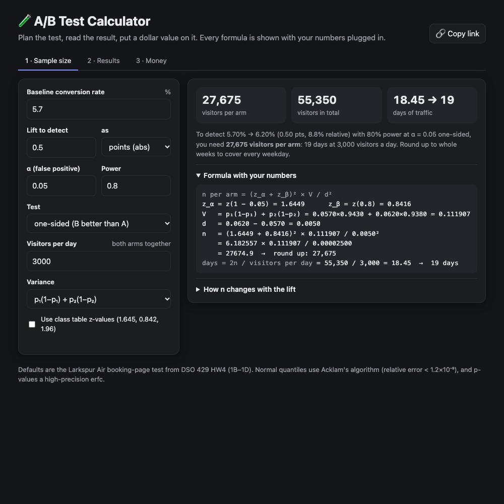
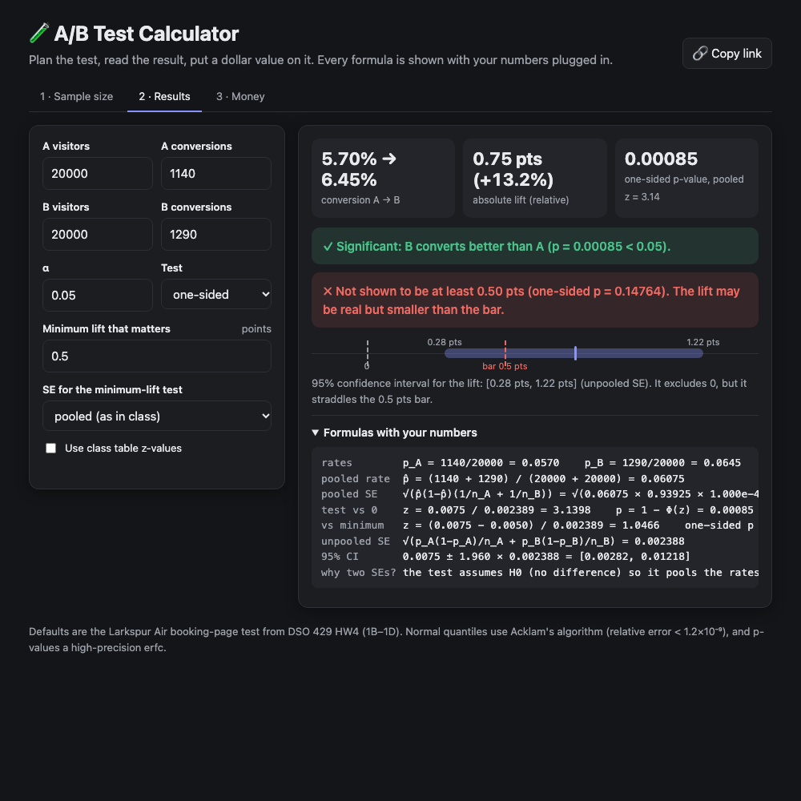
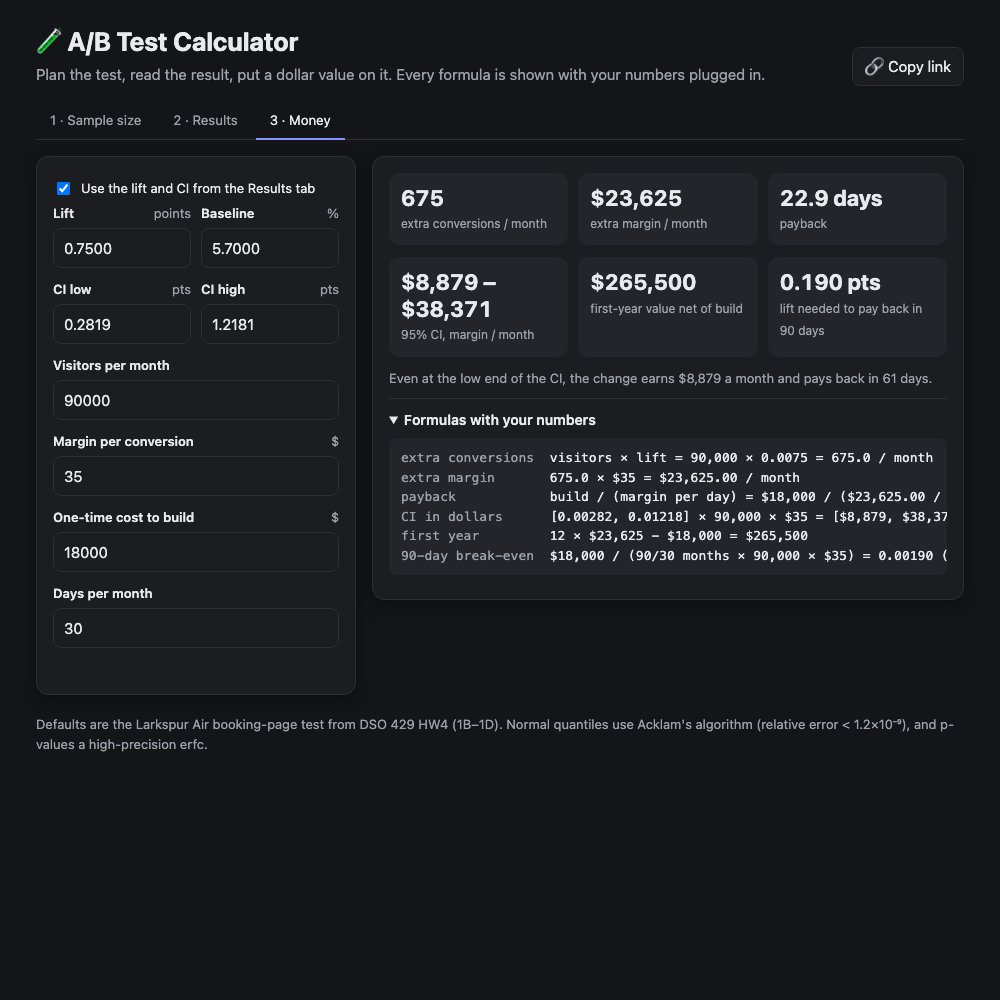

# A/B Test Calculator 🧪

A clean, single-file web tool for the three questions every A/B test raises. **Every formula is shown with your numbers plugged in**, so you can learn from it.

| 1 · Sample size | 2 · Results | 3 · Money |
|---|---|---|
|  |  |  |

## Tabs

1. **Sample size.** Inputs: baseline rate, lift to detect (absolute points or relative %), α, power, one- or two-sided, and visitors per day. Outputs: visitors per arm, the total, and days of traffic. A table shows how n changes as the lift doubles or halves (n ∝ 1/lift²).
2. **Results.** Enter visitors and conversions for A and B. You get:
   - the **pooled z-test** and p-value
   - the **confidence interval** for the lift (unpooled SE), drawn against 0 and your bar
   - a **test against a minimum lift** (for example Finance's 0.5-point bar), with a pooled (as in class) or unpooled SE
   - a note on why the test and the CI use different SEs
3. **Money.** Converts the lift into extra conversions and margin per month, payback days, a **dollar CI**, first-year value net of the build cost, and the lift needed to pay back within 90 days. It can link to the Results tab.

**Other features:**
- **Class z-values:** an option to use the class tables (1.645, 0.842, 1.96) instead of exact quantiles.
- **Variance:** choose unpooled p₁q₁ + p₂q₂ or pooled 2p̄q̄ for sample size.
- **Shareable links:** "Copy link" saves every input in the URL.
- **Layout:** dark mode and phone layout.

## Tests: checked against my HW4 answers

```
node test.mjs
```

There are 19 checks. They load the `<script id="core">` block straight from `index.html`:

| HW4 | Check | Result |
|---|---|---|
| 1B | pooled p̂ 0.06075, SE 0.002389, z = 3.14, one-sided p = 0.00085 | ✓ |
| 1B | vs the 0.5-pt bar: z = 1.05, p = 0.148, fail to reject; ±0.39 pt margin | ✓ |
| 1C | lift 0.75 pts (13.2%), 675 bookings and $23,625 a month, payback 22.9 days | ✓ |
| 1C | unpooled SE 0.002388, 95% CI [0.00282, 0.01218] → [$8,879, $38,371] a month | ✓ |
| 1D | 27,687 per arm (raw 27,686.5), 18.5 → 19 days; 7,192 (raw 7,191.0), 4.8 → 5 days | ✓ |
| 1D | pooled-variance note: 27,690 and 7,195 | ✓ |

The tests also check:
- **Input validation:** impossible inputs are rejected.
- **Exact z-values:** they give 27,675, slightly below the table-based 27,687.
- **Normal functions:** the CDF and inverse CDF match Python's `statistics.NormalDist` to 1e-7 and 1e-9.

## Run

Open `index.html`. Link straight to a tab with `#size`, `#results` or `#money`.
